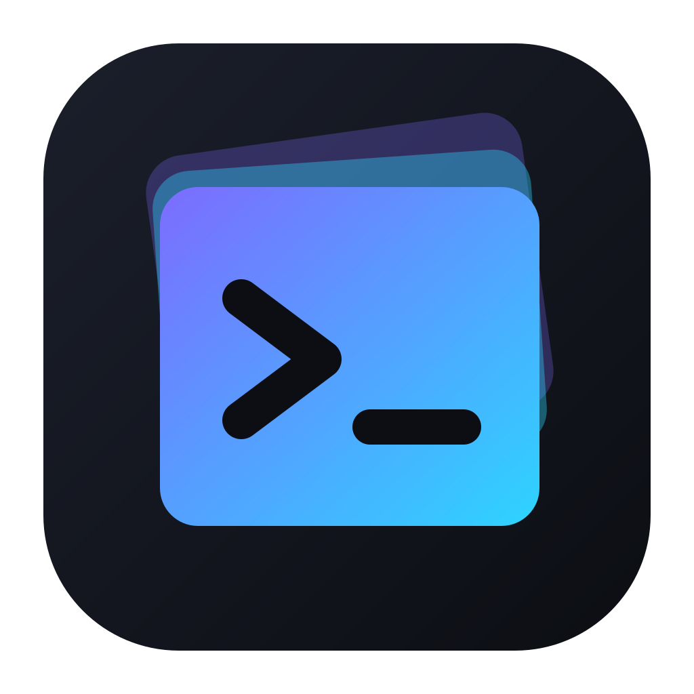
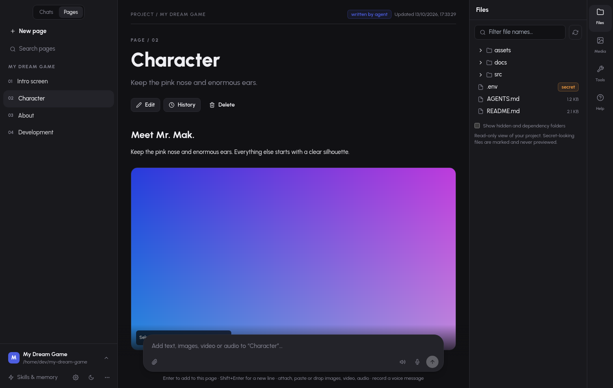
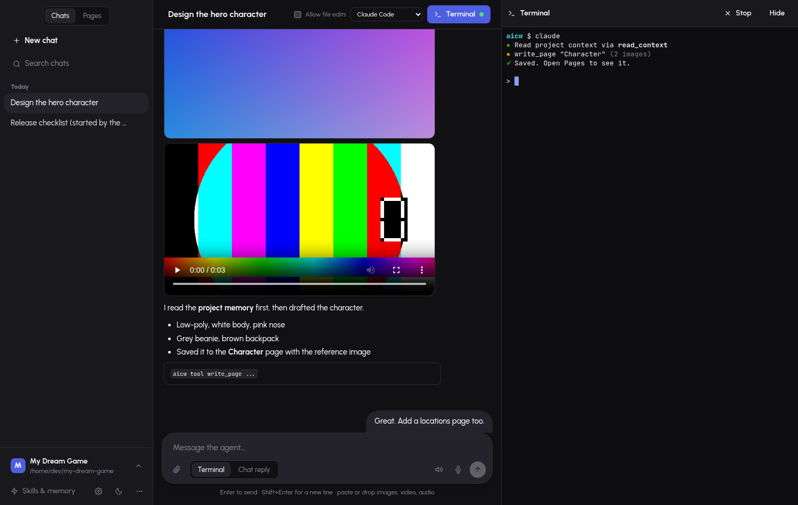
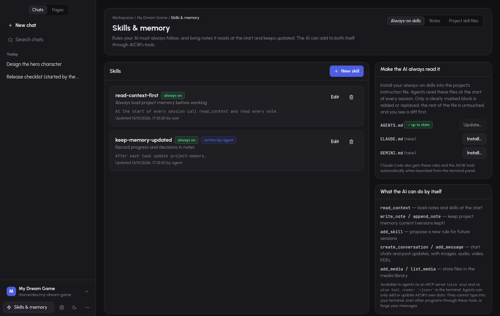
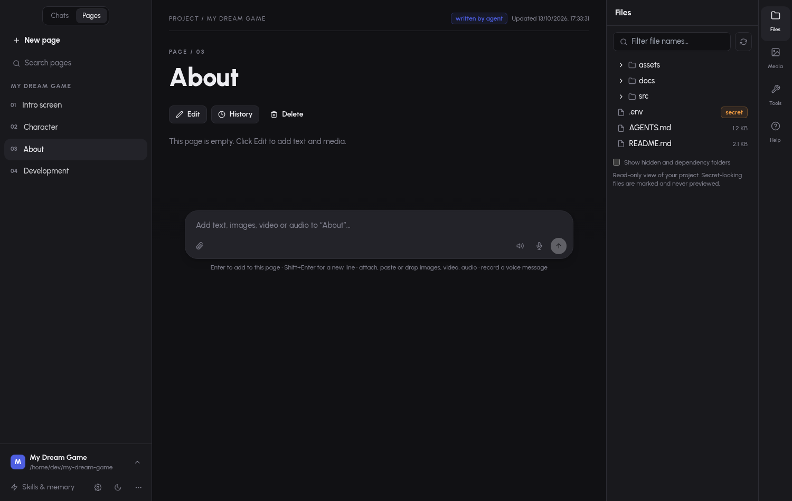
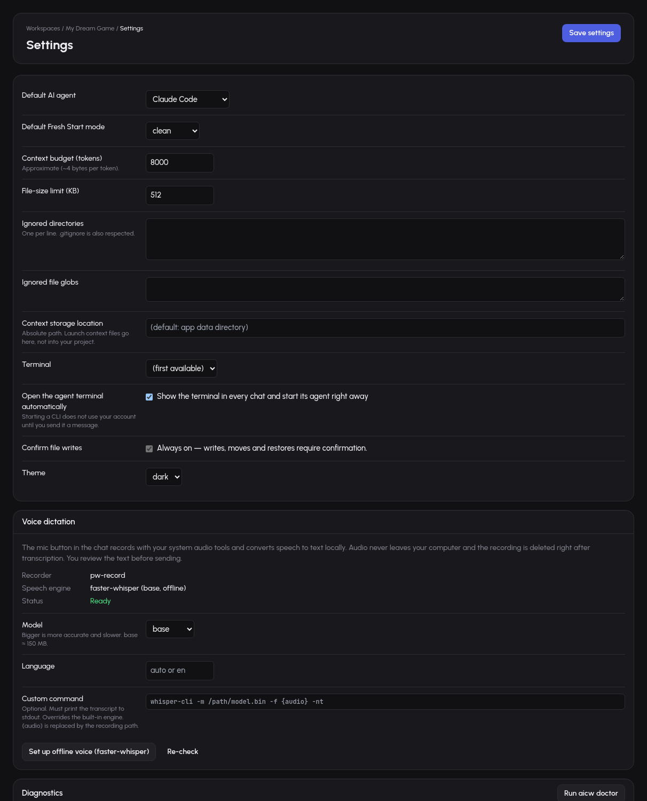

<p align="center"></p>

<h1 align="center">AI Context Workspace (<code>aicw</code>)</h1>

<p align="center"><b>Fresh sessions. Smarter context. Better coding.</b></p>

A desktop app for talking to your AI coding CLI (Claude Code, Kilo, AGY, Codex, Gemini, …) from a ChatGPT-style window, with a real terminal inside it, rich saved *pages*, always-on skills and memory the AI must read and keep updated, and tools that let the AI add data by itself. Built with Go, Wails, React, TypeScript, Tailwind and SQLite. Linux first.



> The screenshots in this README were taken from the real front end running against **sample data** in a headless browser, not from a live AI session.

## Contents

- [Features](#features)
- [Screenshots](#screenshots)
- [Download and install](#download-and-install)
  - [Windows](#windows-experimental)
- [Using it](#using-it)
- [Where your data lives](#where-your-data-lives)
- [Status: what is and isn't verified](#status-what-is-and-isnt-verified)
- [Development](#development)
- [Documentation](#documentation)

## Features

- **Chat with your AI CLI.** Conversations per project. The composer takes text, images, audio, video and PDFs (attach, drop or paste). Each message goes either to the agent running in the **terminal** or to a background **chat reply** that is posted back as a message (with Stop; file edits are off unless you allow them).
- **Embedded terminal.** A real PTY (xterm.js) in each chat. It opens directly and starts the chat's agent, resuming its session if there is one.  With Claude Code, what is said in the terminal also appears in the chat view, so you can continue in either.
- **Choose the model per agent.** *Chat options* (and the AI Agents page) has a model list for each CLI, filled from the CLI itself: `kilo models`, `agy models` and Claude Code's aliases. Nothing is pre-selected: until you pick one the CLI uses its own. You can also type any model name.
- **Local models, no Ollama.** *Settings → Local models* downloads llama.cpp's own server (about 20–30 MB, checksum-verified) and a model (Qwen2.5-Coder, Qwen3, Llama 3.2; 2–5 GB, resumable) into AICW's data folder. The server starts only when you use it and stops when you quit. Pick the model under *Chat options → Model → Local*; it runs through Claude Code, which AICW points at the local server for you. Small local models are far weaker than hosted ones. You can also drop your own `.gguf` files into the `models` folder.
- **Fixed commands.** Type `/` in the composer: `/grill-me` (the AI interviews you one question at a time until it has everything), `/write-pages` (it saves the whole conversation into pages by itself; there is also a **Write to pages** button above the chat), `/summarize`, `/plan`, `/review`, and the **Elephant-Goldfish** design flow `/egm-brainstorm` → `/egm-draft` → `/egm-review` (a long-running "elephant" session designs with no code; fresh, zero-context "goldfish" reviewers then test the written design). They work in both the terminal and chat-reply modes.
- **Pages.** Everything worth keeping becomes a rich project page: headline, text, images, video, audio. Add data to a page straight from its composer, or use *Save to page* on any chat message. Versions are kept.
- **Skills & memory.** Write always-on skills (rules the AI must follow) and living notes it reads first and keeps current. One click installs them into `AGENTS.md` / `CLAUDE.md` / `GEMINI.md` inside a marked block (diff, confirmation, backup).
- **AI tools.** The AI can create conversations, post messages with attachments, write pages, notes and skills, and add media through an **MCP server** (`aicw mcp`) or `aicw tool <name> '<json>'`.
- **Voice.** Dictate text, or record a voice message that is kept as an audio attachment with a transcript. Speech-to-text runs locally (one-click offline setup). Nothing is auto-sent.
- **Safe by default.** Writes to your project show a diff, need confirmation, are backed up and logged. Secret-looking files are kept out of context, previews and media. Skills and repo text are treated as untrusted. See [docs/SECURITY.md](docs/SECURITY.md).
- **More under the sidebar's “…” menu:** project overview, Fresh Start wizard, context package export, media library, agent compatibility, session history.

## Screenshots

| | |
| --- | --- |
|  |  |
| **Chat + embedded terminal.** Attachments inline, *Terminal / Chat reply* switch, voice-message and dictation buttons. | **Skills & memory.** Always-on skills, install into `AGENTS.md`, what the AI can do by itself. |
|  |  |
| **Add data to a page** with text, images, video, audio or a voice message. | **Settings → Voice.** Recorder, offline speech engine, model, custom command. |

## Download and install

Linux (x86-64) is the supported platform today. Windows is **experimental**: see [Windows](#windows-experimental) below. macOS is **not built or tested**.

The Linux steps follow; **Windows users can jump to [Windows](#windows-experimental).**

### 1. Install the system libraries

The app uses GTK 3 and WebKitGTK 4.1.

| Distro | Run-time packages | Extra for building |
| --- | --- | --- |
| Arch / Manjaro | `sudo pacman -S gtk3 webkit2gtk-4.1` | `go nodejs npm git pkgconf` |
| Debian / Ubuntu | `sudo apt install libgtk-3-0 libwebkit2gtk-4.1-0` | `golang nodejs npm git pkg-config libgtk-3-dev libwebkit2gtk-4.1-dev` |
| Fedora | `sudo dnf install gtk3 webkit2gtk4.1` | `golang nodejs npm git pkgconf-pkg-config gtk3-devel webkit2gtk4.1-devel` |

You also need **Go ≥ 1.26** and **Node ≥ 20** to build, and `git` at run time for Git status. Your AI CLI (for example `claude`, `kilo`, `agy`) must be installed and signed in separately.

### 2a. Build from source (works today)

```bash
git clone https://github.com/EthicalGopher/ai_context_manager.git
cd ai_context_manager
scripts/build.sh 0.2.0        # builds the frontend and build/bin/aicw
scripts/install.sh            # installs to ~/.local (no root needed)
aicw doctor                   # checks PATH, data folder, database, terminals, agent CLIs
```

### 2b. Make a release tarball

```bash
scripts/package.sh 0.2.0      # -> dist/aicw-0.2.0-linux-amd64.tar.gz + .sha256
tar -xzf dist/aicw-0.2.0-linux-amd64.tar.gz
cd aicw-0.2.0-linux-amd64 && ./install.sh
```

The repository also contains a GitHub Actions workflow (`.github/workflows/release.yml`) that builds and attaches this tarball when a `v*` tag is pushed. **It has never been run**, and no release has been published yet, so there is no prebuilt download to link to.

### Windows (experimental)

Windows 10 version 1809 or newer, x86-64. It cross-compiles and passes `go vet`, but it has **not been run on a real Windows machine yet**, so expect rough edges and please report them.

**1. Install the prerequisites** (for example with `winget`):

```powershell
winget install GoLang.Go OpenJS.NodeJS.LTS Git.Git
```

- **Go ≥ 1.26** and **Node ≥ 20** are needed to build; `git` is used at run time for Git status.
- **WebView2 runtime**: already on Windows 11 and current Windows 10. Otherwise install it from Microsoft ("Evergreen Bootstrapper").
- Your AI CLI (`claude`, `kilo`, `agy`, …) installed and signed in separately. npm-installed CLIs (`.cmd` shims) work in the embedded terminal.
- Optional, for voice recording: **ffmpeg** on `PATH`. If the wrong microphone is picked, set `AICW_AUDIO_DEVICE` to its DirectShow name.

**2. Build and install** (PowerShell):

```powershell
git clone https://github.com/EthicalGopher/ai_context_manager.git
cd ai_context_manager
scripts\build.ps1 0.2.0                       # builds the frontend and build\bin\aicw.exe

# put aicw.exe somewhere on your PATH (per-user, no admin needed)
New-Item -ItemType Directory -Force "$env:LOCALAPPDATA\Programs\aicw" | Out-Null
Copy-Item build\bin\aicw.exe "$env:LOCALAPPDATA\Programs\aicw\"
[Environment]::SetEnvironmentVariable("Path", "$env:Path;$env:LOCALAPPDATA\Programs\aicw", "User")
```

Open a **new** terminal, then run `aicw doctor` to check PATH, data folder, database and agent CLIs, and `aicw .` to open a project.

| | |
| --- | --- |
| Data folder | `%LOCALAPPDATA%\aicw` (override with `AICW_DATA_DIR`) |
| Terminal launch | Windows Terminal (`wt`) if installed, otherwise `cmd` |
| Upgrade | Rebuild and copy over `aicw.exe` (close the app first). Your data is kept |
| Uninstall | Delete `%LOCALAPPDATA%\Programs\aicw`, remove it from `Path`, and delete `%LOCALAPPDATA%\aicw` to remove your data |
| Not available | A prebuilt installer; there is no signed `.exe`/`.msi` yet, and Windows SmartScreen may warn about a locally built binary |

### Installer details (Linux)

| | |
| --- | --- |
| Install | `./install.sh` → `~/.local/bin/aicw`, a `.desktop` entry and an icon under `~/.local/share`. `PREFIX=/opt/aicw ./install.sh` for another location |
| PATH | If `aicw` is not found, add `export PATH="$HOME/.local/bin:$PATH"` to `~/.bashrc` or `~/.zshrc` (fish: `fish_add_path ~/.local/bin`) |
| Upgrade | Run `./install.sh` from the newer tarball or checkout. The binary is swapped atomically; your data and database are kept (the database is copied to `aicw.db.bak-vN` before any schema change) |
| Uninstall | `./uninstall.sh` removes program files only. `./uninstall.sh --purge-data` asks you to type `delete` before removing your data |
| Verify | `sha256sum -c aicw-0.2.0-linux-amd64.tar.gz.sha256` |

There is no AppImage, `.deb`, `.rpm` or AUR package yet. See [docs/PACKAGING.md](docs/PACKAGING.md).

## Using it

```bash
aicw                     # open the app
aicw .                   # open or resume the workspace in this folder
aicw ./my-project        # relative path (spaces are fine)
aicw ~/code/project      # ~ is expanded
aicw --page pages .      # open a specific page: chat, terminal, pages, skills, settings, ...
aicw --new .             # start a new Fresh Start (existing sessions are kept)
aicw doctor              # diagnostics
aicw tool <name> '<json>'     # for AI agents: notes, pages, media, conversations (needs AICW_WORKSPACE)
aicw mcp --workspace .        # MCP server over stdio for agent CLIs
```

If the app is already running, `aicw <path>` hands the request to it, raises the window and exits 0.

1. Run `aicw .` in a project (or use *Open folder…* in the app).
2. Start a chat and choose where messages go: **Terminal** (typed into the running agent) or **Chat reply** (answer posted as a message).
3. Open **Skills & memory**, add the starter skills, and *Install…* them into `AGENTS.md` so the AI reads and updates your notes.
4. Use **Pages** to keep the results: *Save to page* on a message, or type, attach and record straight into a page.
5. For voice, open **Settings → Voice** and use *Set up offline voice* (downloads faster-whisper into AICW's own folder after you confirm).

## Where your data lives

By default in `~/.local/share/aicw` (override with `AICW_DATA_DIR`): `aicw.db` (chats, pages, notes, skills, sessions, settings), `media/` (private copies of attachments), `history/` (backups and a log of project-file changes), `contexts/`, `mcp/`, `voice/`. **Nothing is written into your project unless you confirm it** (for example installing the skills block into `AGENTS.md`). Pages and chats are in the database, not Markdown files. Copy the folder (with the app closed) to back it up.

## Status: what is and isn't verified

| Area | State |
| --- | --- |
| Linux desktop app, `aicw` CLI, single-instance hand-off | Built and run on Arch Linux (KDE/Wayland) |
| Chat replies | Claude Code, Kilo, AGY (flags checked against each CLI's `--help`). **Tested with fake CLIs only; no real paid agent call was made.** Codex, Gemini, Freebuff have no chat mode (use the terminal) |
| Embedded terminal | PTY layer tested in Go; xterm rendering checked in headless Chrome with canned output. Typing into a live agent in the real window was **not** exercised |
| AI tools (MCP / `aicw tool`) | Tested through the real binary and Go tests. Claude Code's `--mcp-config` hookup is built from its documented flags but **not run against a real Claude session** |
| Voice | Recording format verified on a real mic; offline engine run on synthetic speech (imperfect transcript; expect better with real speech or the `small` model). Live dictation end to end not verified |
| Windows | **Experimental.** ConPTY terminal, Windows Terminal/cmd launch, taskkill-based stop, `%LOCALAPPDATA%\aicw` data dir and ffmpeg/DirectShow voice recording are implemented; the exe cross-compiles and `go vet` passes, but nothing has run on Windows yet |
| macOS | **Not supported yet** (terminal launch and voice recording are not implemented) |
| Release artifacts | Tarball builds and installs locally. CI and release workflows have never run |

Details: [docs/TESTING.md](docs/TESTING.md).

## Development

```bash
git clone https://github.com/EthicalGopher/ai_context_manager.git && cd ai_context_manager
(cd frontend && npm ci)
go test ./... && (cd frontend && npm test)           # Go and frontend tests
scripts/build.sh dev && ./build/bin/aicw .           # rebuild and run from source
scripts/e2e-cli.sh && scripts/e2e-gui.sh             # end-to-end checks (the GUI one needs a display)
scripts/ui-qa.sh out "#/p/2" "#/c/1?term=1"          # headless-Chrome screenshots with a mock backend
```

> **Go 1.27 caveat:** the Wails CLI v2.13 (`wails build` / `wails dev`) fails on Go 1.27 with `internal error: package "errors" without types`. `scripts/build.sh` runs `go build -tags desktop,production[,webkit2_41]`, which is what Wails runs underneath. `wails dev` hot reload is unverified.

## Documentation

[Agent tools, chat, pages, skills, voice](docs/AGENT_TOOLS.md) · [Architecture](docs/ARCHITECTURE.md) · [Security](docs/SECURITY.md) · [CLI](docs/CLI.md) · [Agent integrations](docs/AGENT_INTEGRATIONS.md) · [Session persistence](docs/SESSION_PERSISTENCE.md) · [Context format](docs/CONTEXT_FORMAT.md) · [Packaging](docs/PACKAGING.md) · [Testing](docs/TESTING.md) · [Reference analysis](docs/REFERENCE_ANALYSIS.md) · [Implementation plan](docs/IMPLEMENTATION_PLAN.md) · [Changelog](CHANGELOG.md)

## Credits

Inspired by the workflow of [`witnesstodark/mr-mak-workspace`](https://github.com/witnesstodark/mr-mak-workspace) (MIT). No code was copied; see [docs/REFERENCE_ANALYSIS.md](docs/REFERENCE_ANALYSIS.md).

## License

No license file has been added yet. Until the owner adds one, all rights are reserved by default.
